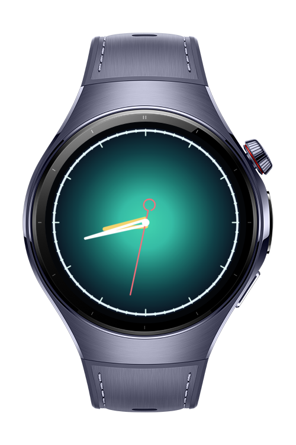
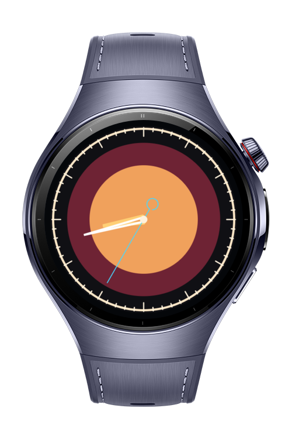
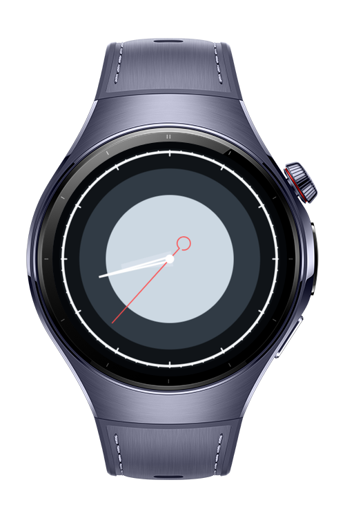

> **Note:** To access all shared projects, get information about environment setup, and view other guides, please visit [Explore-In-HMOS Index](https://github.com/Explore-In-HMOS/hmos-index).

# How To Build Watch Face Painter

**How To Build Watch Face Painter** is a HarmonyOS wearable codelab that builds a customizable analog watch face from ArkGraphics2D drawing primitives.

The sample uses a `Canvas` backed by `DrawingRenderingContext` as the drawing surface, then combines `Brush`, `Pen`, `Path`, and `RoundRect` to paint a dial, bezel, tick marks, decorative arcs, and moving hands.

# Preview

<div align="center">
  
  
  
</div>

# Use Cases

- **Custom watch faces**: Render circular dials and bezels directly with ArkGraphics2D primitives.
- **Primitive styling**: Switch `Brush` palettes and `Pen` cap or join styles without high-level shape components.
- **Path construction**: Build tick marks and decorative arcs with `moveTo`, `lineTo`, `arcTo`, and `close`.
- **Wearable rendering**: Keep the drawing surface compact, centered, and readable on a circular display.

# Technology

## Stack

- **Languages**: ArkTS, ArkUI
- **Frameworks**: HarmonyOS SDK 6.0.0(20)
- **Tools**: DevEco Studio NEXT
- **Libraries**:
  - `@kit.ArkGraphics2D`
  - `@kit.ArkUI`
  - `@kit.AbilityKit`

# Directory Structure

```text
entry/src/main/ets/
|--- components/
|    |--- WatchFaceCanvas.ets
|--- constants/
|    |--- WatchFaceConstants.ets
|--- entryability/
|    |--- EntryAbility.ets
|--- entrybackupability/
|    |--- EntryBackupAbility.ets
|--- model/
|    |--- WatchFaceModel.ets
|--- pages/
|    |--- Index.ets
|--- services/
|    |--- WatchFacePainter.ets
|    |--- WatchTimeService.ets
```

# Constraints and Restrictions

## Supported Devices

- Huawei Watch 5
- DevEco Studio wearable simulator

## Project Constraints

- Single `EntryAbility`
- Empty Ability template
- Wearable device family only
- No runtime permissions required

# License

**How To Build Watch Face Painter** is distributed under the terms of the MIT License.
See the [LICENSE](/LICENSE) for more information.
